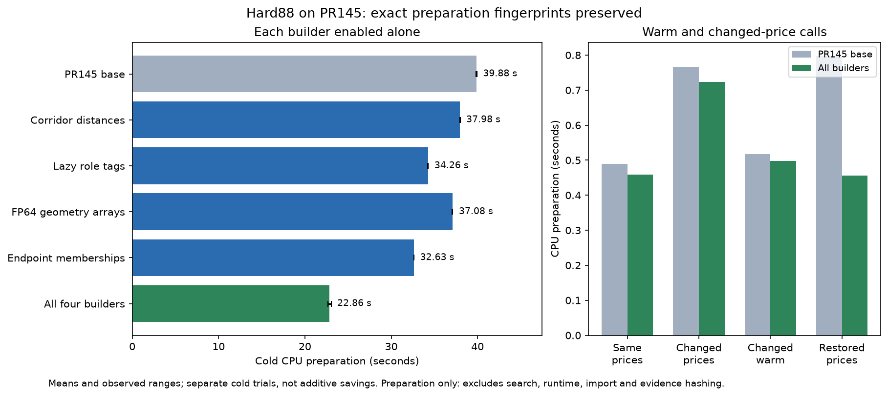
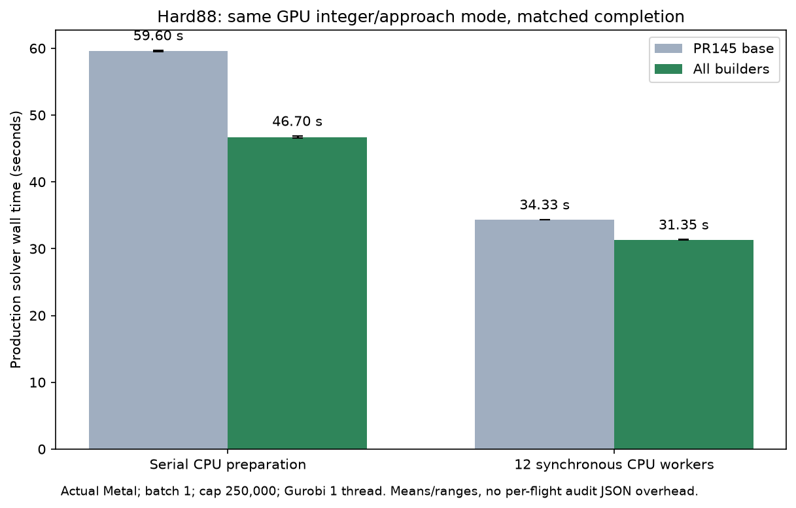

# Cold CPU preparation builders

Implementation and measurements use PR145 `b605aba3b5d9a29ad70cfe5b4e6ab6e4ed57182c`
on main `ebc60608`. This supersedes the earlier diagnosis-only approval gate.
The PR is rebased on main `c62e8bbe` after PR145 merged. A fresh main-based validation passes all 264 focused tests and the full Metal
solve with identical cost, bounds, rounds and dispatches (see `builder_data/main-validation`).
The only production
change from the measured b605 base is main's resident-storage cap increase from
128 to 256 MiB; measured source hashes remain labeled b605. The historical fc30 diagnosis/evidence is preserved unchanged and is not a timing
baseline for these changes. No integer-cache branch, GPU rewrite or overlap is included.

## Implemented stages

| Stage | Exact target | Change | Preserved contract |
| --- | --- | --- | --- |
| Corridor | `network.py:771 _LazyCorridorCells._within_budget` | Direct integer nearest-endpoint loop avoids per-lane generator/function calls | Same unbounded integer hex distance and lane set; no eager ellipse materialization; exclusion precedence unchanged |
| Role tags | `network.py:1333 _static_hop_allowed_roles` | Query the existing exact wall broad phase before computing terminal tags and role variants | Same canonical subvolumes/AABBs; only an empty candidate set bypasses tag work; all four roles and first/last precedence retained |
| Geometry | `gpu_bounds.py:54 _edge_geometry`, `:321 _build_geometry` | NumPy FP64 blocks of at most 65,536 arcs reduce edge bounds and subdivision counts | Same represented hex centers, operation order and individual outward rounding steps; unchanged fallback and subsequent fold/error proof |
| Endpoint | `gpu_endpoint.py:61 _build_arrivals`, `:149 EndpointBounds.__init__` | Construct each unique row identity once, sharing immutable time-incidence arrays across spatial rows; union the mandatory final visit by row identity | All unpriced memberships retained; canonical absolute clock and addition association preserved; distinct destination choices are not collapsed |

These change construction inside the existing caches, not the cache policies or
legal domain. Endpoint cache dependencies remain configuration, absolute arrival
range, destination set and visit offsets. Row selection, signed original prices,
root unions, both mask words and weighted trees are rebuilt as before. Shared
arrays are readonly. Interrupted builds cannot be published. The canonical
arrival-union helper remains an independent test oracle.

PR145's `prepare_flight`, export/restore schema and owner-only GPU runtime remain
unchanged. Workers can export the same selected membership arrays; pickle may
share identical arrays within a reply. No graph, price view or callback is added
to the payload. Numeric root/bound preparation receives identical original FP64
coefficients and complete unions. No changes to kernels, pruning, canonical
completion validation, caps, deadlines, solver settings or defaults.

## Measurement method

`builder_benchmark.py` measures only `prepare_flight` with the original hard88
cohort/order and early/late captures. It checks exact component fingerprints
outside measured intervals: topology/roles, roots, FP64 bytes, complete endpoint
memberships, selected payload, seed column and signed negative credit. Cold,
same-price warm, changed-price, changed warm and restored phases share graphs
within each fresh process. These CPU-only calls do not search or produce pricing
certificates, and their timings must not be called end-to-end speedups.

For isolated trials, disabled builder functions are restored by AST from the
frozen b605 source archive; no production feature flag or altered input is used.
The manifest records the enabled stage and actual source hashes. Two runs use
opposite stage order. The base imports directly from the source archive. Hashing,
exporting payloads, loading captures and snapshot indexing are excluded from
preparation seconds, but included in process RSS. No profiler, tracing allocator,
JIT or device runtime is used in this preparation-only timing.

`builder_solve.py` adapts PR145's inspected `parallel_profile.py --direct`: actual
Metal, checked-integer and approach bounds enabled, batch 1, cap 250,000, chunk
2,048, Gurobi 1 thread; serial or 12 synchronous preparation workers. It keeps
full-CPU-pricer and CPU per-prune verifier guards, solver verification and
iteration telemetry. Per-flight audit JSON rewriting is excluded. Compare base
and candidate only at identical worker settings and matched completion/results;
CPU12 results from the handoff are a different algorithmic result and are not
used as a speedup denominator.

Raw records are bundled in `cpu_builder_evidence.zip`; from the repository root,
extract them with `unzip analysis/colgen/cpu_builder_evidence.zip 'analysis/colgen/builder_data/*'`.
The archive preserves the original measured sources/report; current PR notes
and normalized CSV line endings are maintained separately outside that archive.
Create `.agent/builder-base` before the source-archive command below.

Every sustained job holds the shared `fcntl.flock`; launchers leave a two-second
unlocked window between jobs. `builder_locked.py` records exact commands and
process exits. `run_builder_trials.py` schedules the repetitions, controls and
solver matrix. Raw outputs are under `builder_data/`; historical files remain
under `cpu_preparation_data/`. Recreate the frozen source without switching the
checkout using `git archive b605aba3 | tar -x -C .agent/builder-base`, then run the
launcher with the shared root virtualenv. `PYTHONHASHSEED=0` is fixed; array and
membership fingerprints are independently canonicalized.

<!-- BUILDER_RESULTS_START -->
Two fresh processes per hard88 variant; values are mean [observed range] seconds.

| Builder enabled alone | Cold preparation | Reduction from base |
| --- | ---: | ---: |
| base (n=2) | 39.878 [39.828, 39.929] | 0.0% |
| corridor (n=2) | 37.978 [37.970, 37.986] | 4.8% |
| roles (n=2) | 34.261 [34.230, 34.292] | 14.1% |
| geometry (n=2) | 37.081 [37.033, 37.130] | 7.0% |
| endpoint (n=2) | 32.628 [32.619, 32.637] | 18.2% |
| all (n=2) | 22.860 [22.678, 23.043] | 42.7% |

Individual reductions are **not additive**. These are CPU preparation times.

| Phase | Base | All builders |
| --- | ---: | ---: |
| cold | 39.878 [39.828, 39.929] | 22.860 [22.678, 23.043] |
| warm | 0.489 [0.489, 0.489] | 0.459 [0.459, 0.460] |
| changed | 0.766 [0.760, 0.773] | 0.724 [0.716, 0.731] |
| changed_warm | 0.518 [0.510, 0.526] | 0.498 [0.496, 0.500] |
| restored | 0.797 [0.791, 0.803] | 0.456 [0.455, 0.457] |

All 3,298 recorded flight calls match the base's exact component fingerprints.

Direct production solver wall (same integer/approach search and result):

| Preparation workers | Base wall | All builders wall | Reduction |
| --- | ---: | ---: | ---: |
| 0 | 59.600 [59.503, 59.697] (n=2) | 46.700 [46.534, 46.866] (n=2) | 21.6% |
| 12 | 34.332 [34.292, 34.372] (n=2) | 31.346 [31.316, 31.376] (n=2) | 8.7% |

All 8 completed solver runs match exact final cost 8708.244488722932, LP objective/bounds, per-round columns and reduced-cost statistics, 4 rounds, 352 completed pricing calls and 10,776 dispatches. All are certified and verified; no full CPU fallback or CPU numeric verifier is allowed.
<!-- BUILDER_RESULTS_END -->

The 13-flight control set also matches all five phases: cold CPU preparation
5.804 to 3.365s in one base/candidate pair. The new separate audited 12-worker
solve passes all 352 canonical result audits and matches the direct solver's
cost/bounds/dispatches. It takes 40.576s versus the 31.346s direct mean, confirming
roughly 9.23s of audit/harness overhead; it is excluded from speedup calculations.

New audited telemetry records integer preparation **8.054s**, synchronous group
wall **6.868s**, device execution **0.898s**, owner waits **4.117s** and 10,776
dispatches. There are 754 canonical validations and zero rejections. Worker
preparation sums to 24.991s and cache accounting to 9.744s across workers; these
are not wall times. All these timers overlap and must not be stacked. The integer
encoding candidate remains material after the cold builders. Raw detail is in
`builder_data/all-audited/pricing.json`; aggregation is reproducible with
`summarize_builders.py` and saved in `audit_summary.json`.

## Retention decision and review order

**All four builders plus PR145 parallel preparation** take 31.346s versus
59.600s for serial preparation without the builders: **47.4% less total solver
wall time**. That combined comparison includes PR145's existing parallelization;
the incremental builder benefit with 12 workers remains 8.7%.

Retain the four small builders together: matched direct solver wall falls
**21.6% with serial preparation** (59.600 to 46.700s), exceeding the prior 15%
retention target in both paired repetitions. With PR145's 12 synchronous workers,
the incremental gain is **8.7%** (34.332 to 31.346s), below that target. Do not
attribute PR145's existing parallel speedup to these builders or add the isolated
savings. Defaults remain serial. The combination with 12 workers is the fastest
measured configuration here, but is not a universal worker-count recommendation.

Review in descending measured isolated cold benefit:

| Stage | Isolated cold saving vs mean base | Complexity / risk | Functional evidence |
| --- | ---: | --- | --- |
| Endpoint memberships | 7.250s (18.2%) | Medium: exact unions, canonical clocks and immutable array aliases; removes incidental LRU warming, so later canonical costs matter | Canonical per-arrival equality at terminal/customer endpoints and clock boundaries; both masks, signed/root overlap and worker payload tests |
| Deferred role tags | 5.617s (14.1%) | Low: only empty exact wall candidate sets skip tags; less benefit in wall-dense domains | All four roles, resampling/terminal overrides, topology oracle and exact hard88 arc bytes |
| FP64 geometry arrays | 2.797s (7.0%) | Medium: preserve each outward rounding operation; NumPy temporaries bounded by 65,536-arc blocks plus coordinate array | Scalar FP64 parity, canonical geometry bounds, byte-identical captured coefficients |
| Corridor arithmetic | 1.900s (4.8%) | Low: duplicated integer distance identity must remain equivalent to hex_distance; no new cache or eager domain | Lane-aware corridor oracle, exclusion ordering, lazy materialization/pickle and exact topology bytes |

These are achieved preparation savings on this cohort, not guaranteed gains on
other workloads. The larger absolute serial solver saving is 12.900s, less than
the 17.018s preparation-only reduction: solver initialization, incumbents, domain
changes and search interact with which cold work occurs. End-to-end evidence is
the retention criterion. Further cold-topology compilation should start with a
new profile of the remaining work, rather than extrapolating old hot-function
percentages. Numeric encoding and GPU restructuring remain the separate stages
below; no speedup is claimed for them.

## Allocation and cache evidence

The second cold run inventories **349,355 identical logical endpoint rows** in
both variants. Base construction retains 349,355 arrival arrays / 36,597,368
array bytes; the shared builder retains 177,360 distinct arrays / 18,973,600 bytes
for the same logical incidence. These counts exclude Python object headers.

Canonical endpoint-LRU population falls from 91,396 entries holding 4,537,291 row
references to 3,376 entries / 50,640 references. These are reference counts, not
unique-object counts. The new membership builder avoids incidentally populating
that per-arrival oracle cache; it does not alter the LRU's policy or discard any
mandatory row. This is a substantial additional allocation difference beyond
array sharing. Second-run cold process peaks are 2,191.1 versus 1,430.6 MiB,
including the evidence harness; the full solver must establish the net effect
when later canonical checks populate what they need.

## Functional validation and limits

264 distinct focused cases passed across network, topology, bounds, endpoint and
worker-pool suites. The initial 18 new membership cases failed during fixture
construction because changing dt also shrank the pitch; preserving a legal 120m
pitch fixed the fixture, and all 18 reran successfully. Ruff and whitespace
checks pass.

Existing network/topology tests compare legal arcs, ordering, all four roles,
lazy graph behavior and pickling against independent geometry. Existing bounds,
endpoint and worker tests exercise signed credits, origin overlap, both masks,
changed snapshots/restrictions, budgets, interrupted builds and payload parity.
New compact-membership comparisons cover customer/terminal endpoints, zero/one/
multiple final cells, negative and large clocks, nonbinary periods and changed
visit windows against canonical per-arrival unions. Synthetic weighted-bound
fixtures now inject membership at the builder boundary rather than relying on
an internal allocation path. The independent canonical tests exercise the real
builder. New edge tests compare scalar outward arithmetic with NumPy reductions
at tiny/ordinary/large scales, empty CSR rows, block boundaries and unsupported
subdivision ratios.

RSS includes interpreter, caches, NumPy and evidence hashing; it is not a retained
cache census or a sum of array sizes. Changing endpoint construction also stops
warming the canonical endpoint LRU incidentally; actual solver measurements are
necessary to include any later reconstruction cost. Small controls and warm calls
may have little benefit. Two repeats establish an observed range, not a statistical
confidence interval. CUDA interfaces are unchanged; NVIDIA is untested. No claim
about uncached Metal compilation, other hardware or broad scenario speedup.

## Separate candidate: repeated checked-integer preparation

The user-requested handoff reports 8.018s `integer_prepare_s` across the four-round
PR145 production solve. Owner cProfile reports `IntegerBatch.prepare` 25.272s,
`IntegerData.root_operands` 23.964s, `IntegerScale.encode` 14.004s, with 79.059s
instrumented wall versus about 34.3s normal. These are nested/nonadditive profile
times and supplied evidence, not new cold-builder gains. Historical fc30 small
root-packing costs do not describe checked-integer preparation.

Read-only inspection of `origin/codex/gpu-integer-cache` at `e2831fea` and its
`GPU_INTEGER_CACHE.md` establishes existing bounded snapshot/root-operand and
price-independent cost reuse. Do not propose those caches as new. Its retained
root key includes geometry/configuration, ordered roots, scales, objective,
restrictions, snapshots, selected endpoint identities and masks. Future-bearing
root refreshes bypass persistent reuse. Integration/revalidation of that existing
work should precede new changes to the same files.

Remaining investigation: measure cold and future-generation `root_operands`
assembly separately, hoist truly flight/snapshot-constant encodings, and use the
already existing outward `IntegerScale.encode_array` where exact scalar parity
is established. Separate immutable identities, snapshot weights and generation
rows; invalidate on scale, objective, clock, restrictions, graph/domain, snapshot
and generation as applicable. Test complete packed-word parity, signed tiny and
extreme values, unavailable/overflow cases and changed/restored generations.
Estimate potential benefit only after unprofiled attribution on the integrated
cache branch. This cold-builder implementation changes none of those files.

## Feasibility only: more computation on the GPU

Compact immutable membership identities could support exact price-weighted
reductions and bound-table assembly on device. Device-side search bookkeeping
and compaction could reduce owner round trips. Existing resident buffers already
solve residency for current work; CPU vectorization here is not GPU offload.
The handoff's group-preparation 9.139s, device 0.877s, waits 4.094s and 10,776
dispatches overlap and cannot be summed into achievable savings.

A separate proposal must first prove conservative original-FP64-equivalent
bounds, complete signed unions and negative credits, origin overlap, both masks,
overflow/unavailable handling and correct snapshot/generation invalidation.
Keep the owner-only runtime and CUDA interface compatibility, then measure
matched completion wall time including transfer/dispatch costs. No kernel or
search restructuring is implemented here. Canonical route validation remains:
an unchecked intermediate incumbent cannot safely prune before final validation.
Integer deletions already perform zero CPU per-prune verification, and
`column_claims` is memoized. Neither relaxing checks nor CPU/GPU overlap is part
of this work.
